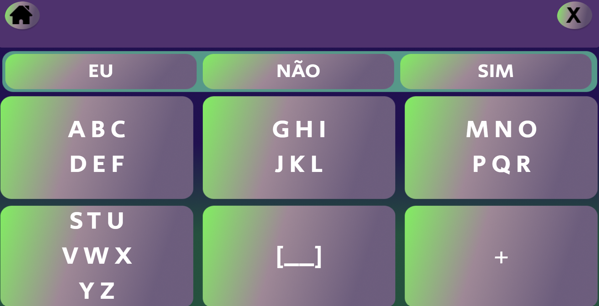
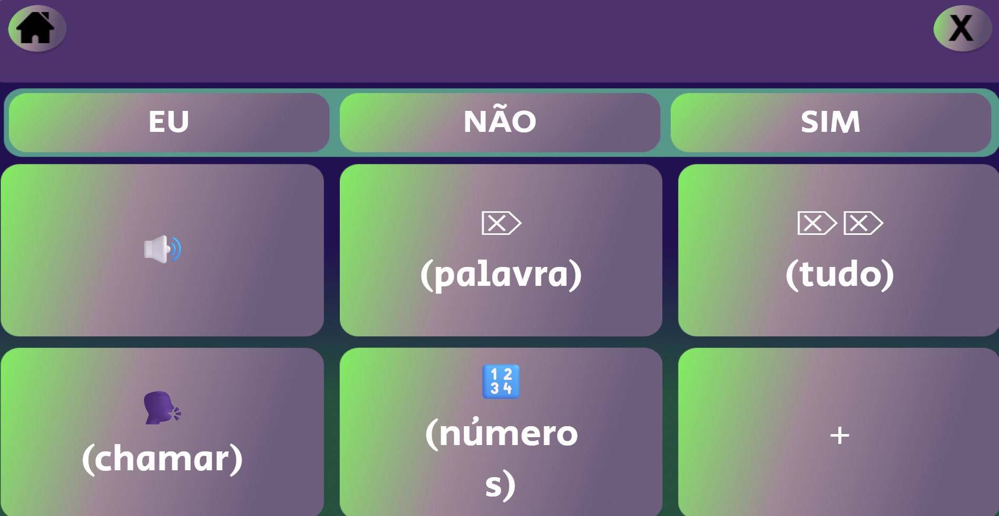
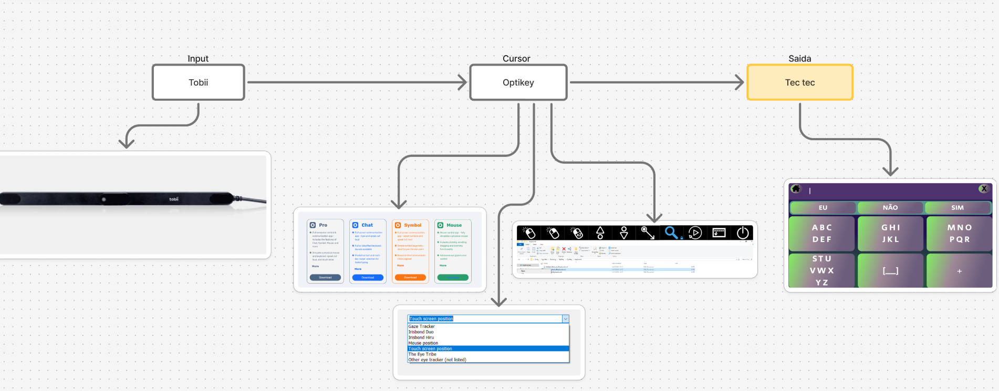

# Teclado Virtual Acessível

## Teclado virtual simplificado em português para pessoas  com limitações motoras ou dificuldades na utilização de dispositivos de entrada convencionais.
#### É um projeto desenvolvido com o objetivo de tornar a comunicação e a escrita digital mais acessíveis para pessoas com limitações motoras ou dificuldades na utilização de dispositivos de entrada convencionais.
#### O teclado possui uma interface simplificada, com botões maiores e em menor quantidade, facilitando a seleção de letras e palavras. Foi pensado especialmente para pessoas que utilizam rastreadores oculares (como o Tobii Eye Tracker), que podem encontrar dificuldades na adaptação a teclados convencionais ou na seleção de botões pequenos.
## Glossário

- [Imagens](#Imagens)
- [Funcionalidades](#Funcionalidades)
- [Como instalar](#Como-instalar-o-programa-executável)
- [Arquitetura do projeto](#Arquitetura-do-projeto)

## Imagens
 

## Funcionalidades

### Botões da tela inicial

* letras de A a Z
* Números de 0 a 9
* Espaço 

### Funcionalidades adicionais

* Apagar a última palavra escrita.
* Apagar todo o texto.
* Chamar (Acionar alarme).
* Leitura em voz alta do texto escrito.
* Salvar textos e copiá-los para a área de transferência.
* Abrir textos salvos e continuar a edição.
   

## Arquitetura do projeto 

### Imagens

### Tecnologias

* Python
* Flask
* HTML
* CSS
* JavaScript

### Requisitos 

* Python 3.10 ou superior
* Bibliotecas:
    * Flask -- `pip install flask`
    * PyWebView --`pip install pywebview`

## Como instalar o programa executável

[📥 Baixar Teclado Virtual Acessível (.zip)](https://drive.google.com/file/d/1I8a5u52rpnj5lxfMPa5gxvVE6OhEp_dK/view?usp=sharing)